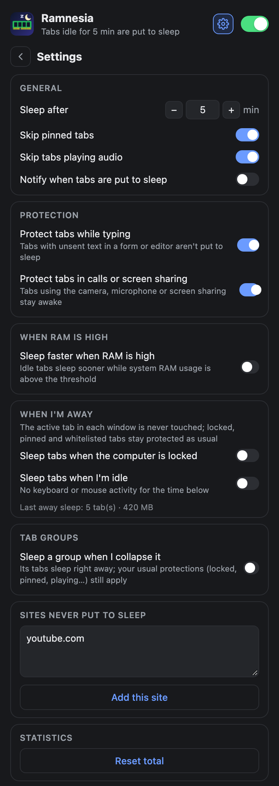

<p align="center">
  
</p>

<h1 align="center">Ramnesia</h1>

<p align="center">
  <em>Forgets your idle Chrome tabs so your RAM doesn't have to.</em><br/>
  <sub><a href="#türkçe">Türkçe açıklama aşağıda</a></sub>
</p>

---

A Chrome extension that puts tabs you haven't used for a while to sleep, and shows how much memory that frees.

<p align="center">
  
  &nbsp;
  
</p>

## What it does

Chrome's built-in Memory Saver decides on its own when to put tabs to sleep. Ramnesia lets you set the rule: any tab you haven't visited for a set time (5 minutes by default) is discarded using Chrome's own `chrome.tabs.discard`. The tab stays in the tab strip and reloads when you click it.

## Features

- Idle tabs are put to sleep after 5 minutes by default. You can set anything from 1 to 240 minutes.
- RAM-pressure mode (off by default). When system RAM usage goes above a threshold (85% by default, adjustable 50–95%), idle tabs are put to sleep sooner (after 1 minute by default).
- The popup shows system RAM usage, how much memory awake tabs use, how much sleeping tabs have freed, and a running total.
- The toolbar icon shows the memory currently freed, for example `270M`.
- Any tab can be locked. A locked tab is never put to sleep, by Ramnesia or by Chrome's Memory Saver.
- You can put one tab to sleep right away, or all of them with "Sleep all". The active tab and locked tabs are skipped.
- Tab search, and a list of sites that should never be put to sleep.
- Pinned tabs and tabs playing audio are skipped by default. Both can be turned off.
- Tabs where you have typed something you haven't sent yet are not put to sleep (on by default).
- Tabs using the camera, microphone or screen sharing are not put to sleep (on by default).
- Optionally, background tabs are put to sleep when the computer is locked or when you've been idle for a while (off by default).
- Tab groups: put a whole group to sleep or lock it from the popup. Optionally, a group is put to sleep as soon as you collapse it (off by default).
- Measured real gain: Ramnesia reads free system RAM just before and a few seconds after tabs are put to sleep, and shows the difference.
- Optional desktop notification when tabs are put to sleep.
- Light and dark theme. English and Turkish, following the browser language.

## Installation

1. Clone or download this repository:
   ```bash
   git clone https://github.com/erencanucarr/ramnesia.git
   ```
2. Open `chrome://extensions` in Chrome.
3. Turn on Developer mode (top right).
4. Click "Load unpacked" and select the project folder.

## How memory is measured

Chrome (Stable and Beta) does not give extensions a tab's real memory use, so Ramnesia works with what it can measure. Values marked `≈` are approximate.

- **Measured real gain.** Ramnesia reads free system RAM (`chrome.system.memory`) just before and a few seconds after tabs are put to sleep. The difference is the real RAM freed. Other programs and the operating system's cache affect it, so implausible readings are discarded.
- **Per-tab estimates.** Each tab's JavaScript memory (`performance.memory`) is measured. After at least 3 reliable real-gain measurements, Ramnesia learns how much real RAM your tabs use per byte of JavaScript memory (for example ×3.2) and shows tabs as JavaScript memory × that factor. Until then the raw JavaScript memory is shown, which is lower than the real use. The factor can be reset under Settings → Statistics.
- **Exact values on Chrome Dev/Canary.** There, the `chrome.processes` API gives each tab's real process memory. It is off by default because declaring its permission shows a warning on Stable and Beta. On Dev/Canary, add `"optional_permissions": ["processes"]` to `manifest.json`, reload the extension and turn it on under Settings → General. Tabs that share a process with other tabs are split and marked `≈`.
- Tabs that can't be measured are counted as 50 MB and marked `≈`. They are never used for learning the factor.

## Permissions

| Permission | Used for |
| --- | --- |
| `tabs` | Listing tabs and putting them to sleep |
| `alarms` | Checking for idle tabs every 30 seconds |
| `storage` | Settings and statistics |
| `scripting` and `<all_urls>` | Reading a page's JS heap size, and a small content script that notices unsent typing and camera, microphone or screen capture. What you type never leaves the page and is not stored; only whether a field has changed is reported. |
| `system.memory` | Showing total and free system RAM |
| `notifications` | The optional sleep notification |
| `idle` | Noticing when the computer is locked or idle |
| `tabGroups` | Sleeping and locking tab groups |
| `processes` (not declared by default) | Exact per-tab memory on Chrome Dev/Canary, only if you add it yourself |

No data leaves your device.

## License

[MIT](LICENSE)

---

## Türkçe

Ramnesia, bir süredir kullanmadığın sekmeleri uyutan ve bunun ne kadar bellek boşalttığını gösteren bir Chrome eklentisidir.

### Ne yapar

Chrome'un kendi Bellek Tasarrufu özelliği sekmeleri ne zaman uyutacağına kendisi karar verir. Ramnesia'da kuralı sen belirlersin: belirlediğin süre (varsayılan 5 dakika) boyunca girmediğin sekme, Chrome'un `chrome.tabs.discard` özelliğiyle uyutulur. Sekme sekme çubuğunda kalır, tıkladığında yeniden yüklenir.

### Özellikler

- Kullanılmayan sekmeler varsayılan olarak 5 dakika sonra uyutulur. Süre 1 ile 240 dakika arasında ayarlanabilir.
- RAM doluluk modu (varsayılan olarak kapalı). Sistem RAM kullanımı belirlenen eşiği geçince (varsayılan %85, %50–95 arası ayarlanabilir) sekmeler daha erken uyutulur (varsayılan 1 dakika).
- Açılır pencerede sistem RAM kullanımı, açık sekmelerin kullandığı bellek, uyuyan sekmelerin boşalttığı bellek ve toplam kazanç görünür.
- Eklenti simgesinin üstünde o an boşaltılan bellek yazar, örneğin `270M`.
- Sekmeler kilitlenebilir. Kilitli sekmeyi ne Ramnesia ne de Chrome'un Bellek Tasarrufu uyutur.
- Tek bir sekmeyi hemen uyutabilir ya da "Hepsini uyut" ile hepsini uyutabilirsin. Açık sekme ve kilitli sekmeler atlanır.
- Sekme arama ve hiç uyutulmayacak siteler listesi.
- Sabitlenmiş sekmeler ve ses çalan sekmeler varsayılan olarak atlanır. İkisi de kapatılabilir.
- Henüz göndermediğin bir yazı olan sekmeler uyutulmaz (varsayılan olarak açık).
- Kamera, mikrofon veya ekran paylaşımı kullanan sekmeler uyutulmaz (varsayılan olarak açık).
- İstersen bilgisayar kilitlenince ya da bir süre kullanılmayınca arka plandaki sekmeler uyutulur (varsayılan olarak kapalı).
- Sekme grupları: bir grubun tamamını popup'tan uyutabilir veya kilitleyebilirsin. İstersen grup daraltılınca hemen uyutulur (varsayılan olarak kapalı).
- Ölçülen gerçek kazanç: sekmeler uyutulmadan hemen önce ve birkaç saniye sonra sistemin boş RAM'i okunur, aradaki fark gösterilir.
- Sekmeler uyutulunca isteğe bağlı masaüstü bildirimi.
- Açık ve koyu tema. Tarayıcının diline göre İngilizce veya Türkçe.

### Kurulum

1. Bu depoyu klonla veya indir.
2. Chrome'da `chrome://extensions` adresini aç.
3. Sağ üstten Geliştirici modunu aç.
4. "Paketlenmemiş öğe yükle"ye tıkla ve proje klasörünü seç.

### Bellek ölçümü

Chrome (Stable ve Beta) eklentilere bir sekmenin gerçek bellek kullanımını vermez, bu yüzden Ramnesia ölçebildikleriyle çalışır. `≈` işaretli değerler yaklaşıktır. Sekmeler uyutulmadan hemen önce ve birkaç saniye sonra sistemin boş RAM'i okunur (`chrome.system.memory`); aradaki fark gerçekte boşalan RAM'dir. Diğer programlar ve işletim sisteminin önbelleği etkilediği için mantıksız görünen ölçümler sayılmaz. Her sekmenin JavaScript belleği de ölçülür (`performance.memory`). En az 3 güvenilir ölçümden sonra Ramnesia, JavaScript belleğinin her baytına ne kadar gerçek RAM düştüğünü öğrenir (örneğin ×3,2) ve sekmeleri buna göre gösterir. O zamana kadar ham JavaScript belleği gösterilir; bu, gerçek kullanımdan düşüktür. Öğrenilen oran Ayarlar → İstatistikler'den sıfırlanabilir. Chrome Dev/Canary'de `chrome.processes` ile her sekmenin gerçek süreç belleği okunabilir. Bu izin normal Chrome'da uyarı gösterdiği için varsayılan olarak tanımlı değil; Dev/Canary kullanıyorsan `manifest.json` dosyasına `"optional_permissions": ["processes"]` ekleyip eklentiyi yeniden yükle ve Ayarlar → Genel'den aç. Ölçülemeyen sekmeler 50 MB sayılır, `≈` ile işaretlenir ve oran öğrenilirken kullanılmaz. Yazı koruması için yazdığın metin sayfadan dışarı çıkmaz ve saklanmaz; sadece bir alanın değişip değişmediği bildirilir. Hiçbir veri cihazından dışarı gönderilmez.

### Lisans

[MIT](LICENSE)
