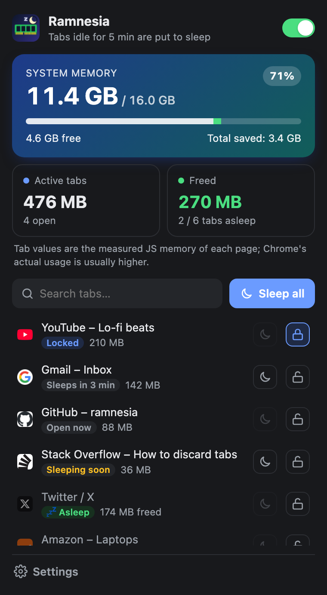

<p align="center">
  
</p>

<h1 align="center">Ramnesia</h1>

<p align="center">
  <em>Forgets your idle Chrome tabs so your RAM doesn't have to.</em><br/>
  <sub><a href="#türkçe">Türkçe açıklama aşağıda</a></sub>
</p>

---

A Chrome extension that puts tabs you haven't used for a while to sleep, and shows how much memory that frees.

<p align="center"></p>

## What it does

Chrome's built-in Memory Saver decides on its own when to put tabs to sleep. Ramnesia lets you set the rule: any tab you haven't visited for a set time (5 minutes by default) is discarded using Chrome's own `chrome.tabs.discard`. The tab stays in the tab strip and reloads when you click it.

## Features

- Idle tabs are put to sleep after 5 minutes by default. You can set anything from 1 to 240 minutes.
- RAM-pressure mode (off by default). When system RAM usage goes above a threshold (85% by default, adjustable 50–95%), idle tabs are put to sleep sooner (after 1 minute by default).
- The popup shows system RAM usage, how much memory awake tabs use, how much sleeping tabs have freed, and a running total.
- The toolbar icon shows the memory currently freed, for example `270M`.
- Any tab can be locked. A locked tab is never put to sleep, by Ramnesia or by Chrome's Memory Saver.
- You can put one tab to sleep right away, or all of them with "Sleep all". The active tab and locked tabs are skipped.
- Tab search, and a list of sites that should never be put to sleep.
- Pinned tabs and tabs playing audio are skipped by default. Both can be turned off.
- Optional desktop notification when tabs are put to sleep.
- Light and dark theme. English and Turkish, following the browser language.

## Installation

1. Clone or download this repository:
   ```bash
   git clone https://github.com/erencanucarr/ramnesia.git
   ```
2. Open `chrome://extensions` in Chrome.
3. Turn on Developer mode (top right).
4. Click "Load unpacked" and select the project folder.

## How memory is measured

Chrome does not give extensions a tab's total memory use, so the numbers are approximate:

- Per-tab numbers are the page's JavaScript heap (`performance.memory`). The real memory use of a tab is higher, so the savings shown are usually lower than the real savings.
- Tabs that can't be measured are counted as 50 MB and marked with `≈`.
- System RAM is read with `chrome.system.memory`.

## Permissions

| Permission | Used for |
| --- | --- |
| `tabs` | Listing tabs and putting them to sleep |
| `alarms` | Checking for idle tabs every 30 seconds |
| `storage` | Settings and statistics |
| `scripting` and `<all_urls>` | Reading a page's JS heap size. Page content is not read. |
| `system.memory` | Showing total and free system RAM |
| `notifications` | The optional sleep notification |

No data leaves your device.

## License

[MIT](LICENSE)

---

## Türkçe

Ramnesia, bir süredir kullanmadığın sekmeleri uyutan ve bunun ne kadar bellek boşalttığını gösteren bir Chrome eklentisidir.

### Ne yapar

Chrome'un kendi Bellek Tasarrufu özelliği sekmeleri ne zaman uyutacağına kendisi karar verir. Ramnesia'da kuralı sen belirlersin: belirlediğin süre (varsayılan 5 dakika) boyunca girmediğin sekme, Chrome'un `chrome.tabs.discard` özelliğiyle uyutulur. Sekme sekme çubuğunda kalır, tıkladığında yeniden yüklenir.

### Özellikler

- Kullanılmayan sekmeler varsayılan olarak 5 dakika sonra uyutulur. Süre 1 ile 240 dakika arasında ayarlanabilir.
- RAM doluluk modu (varsayılan olarak kapalı). Sistem RAM kullanımı belirlenen eşiği geçince (varsayılan %85, %50–95 arası ayarlanabilir) sekmeler daha erken uyutulur (varsayılan 1 dakika).
- Açılır pencerede sistem RAM kullanımı, açık sekmelerin kullandığı bellek, uyuyan sekmelerin boşalttığı bellek ve toplam kazanç görünür.
- Eklenti simgesinin üstünde o an boşaltılan bellek yazar, örneğin `270M`.
- Sekmeler kilitlenebilir. Kilitli sekmeyi ne Ramnesia ne de Chrome'un Bellek Tasarrufu uyutur.
- Tek bir sekmeyi hemen uyutabilir ya da "Hepsini uyut" ile hepsini uyutabilirsin. Açık sekme ve kilitli sekmeler atlanır.
- Sekme arama ve hiç uyutulmayacak siteler listesi.
- Sabitlenmiş sekmeler ve ses çalan sekmeler varsayılan olarak atlanır. İkisi de kapatılabilir.
- Sekmeler uyutulunca isteğe bağlı masaüstü bildirimi.
- Açık ve koyu tema. Tarayıcının diline göre İngilizce veya Türkçe.

### Kurulum

1. Bu depoyu klonla veya indir.
2. Chrome'da `chrome://extensions` adresini aç.
3. Sağ üstten Geliştirici modunu aç.
4. "Paketlenmemiş öğe yükle"ye tıkla ve proje klasörünü seç.

### Bellek ölçümü

Chrome eklentilere bir sekmenin toplam bellek kullanımını vermez, bu yüzden rakamlar yaklaşıktır. Sekme rakamları sayfanın JavaScript belleğidir (`performance.memory`). Sekmenin gerçek kullanımı bundan fazladır, yani gösterilen kazanç genelde gerçek kazançtan düşüktür. Ölçülemeyen sekmeler 50 MB sayılır ve önüne `≈` konur. Sistem RAM'i `chrome.system.memory` ile okunur. Hiçbir veri cihazından dışarı gönderilmez.

### Lisans

[MIT](LICENSE)
